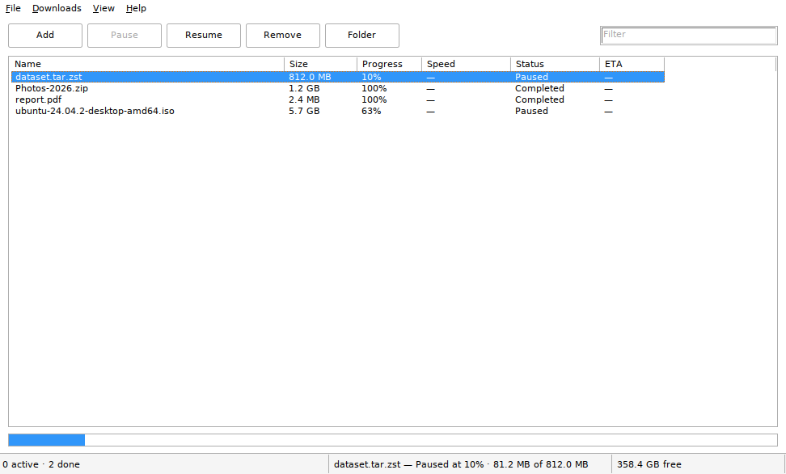

# Tree

**A native Windows download manager in Rust.** Eight parallel connections per
file, resumable, ten themes, video links through yt-dlp, and a single 1.6 MB
executable that needs no runtime, no installer framework and no web view.



```
1.6 MB exe   ·   no VC++ redist   ·   no WebView2   ·   no telemetry   ·   MIT
```

## Why another download manager

Most of them are a browser in a trench coat: an Electron or WebView2 shell that
costs 150 MB of RAM before a single byte is downloaded, with a UI that ignores
the system theme, DPI scaling and keyboard conventions.

Tree is the opposite bet. The window is made of the same controls Explorer uses —
`SysListView32`, `BUTTON`, `msctls_statusbar32`, a real menu bar and the shell's
own message font — so it inherits Windows' theming, high-contrast mode, DPI
behaviour and accessibility for free instead of re-implementing them.

| | Tree | Electron-based manager | Browser |
|---|---|---|---|
| Install size | **1.6 MB** | 80–150 MB | — |
| RAM at idle | **~25 MB** | 150–300 MB | 300 MB+ |
| Threads at idle | **6** | 20+ | 30+ |
| Connections per file | **8 ranged** | 1–4 | 1 |
| Resumes after reboot | **yes, byte-exact** | sometimes | rarely |

## What it does

* **Parallel ranged downloads** — one file, up to 16 connections (8 by default),
  each writing at its own offset into a preallocated part file. No shared cursor,
  no locking in the write path.
* **Real resume** — segment offsets are checkpointed every 2 s, so a pause, a
  crash or a reboot continues from the same byte instead of starting over.
* **Queueing** — three files at a time by default, the rest wait their turn.
* **Correct by construction** — the finished file is truncated to the exact
  length and renamed from `*.tree-part`, so a half-download can never look
  complete. Servers that lie about range support are detected instead of
  producing a corrupt file.
* **Native shell integration** — taskbar progress, tray icon with live
  percentage, drag-and-drop, dark title bar that follows the system theme,
  per-monitor DPI, real modal dialogs, system folder picker.
* **Video and audio links** — anything yt-dlp understands (YouTube, Vimeo,
  SoundCloud, Twitch, …) is handed to the official `yt-dlp.exe`, with the same
  progress, pause and resume behaviour as a normal download. One click in
  **Tools** fetches the binary; no Python needed.
* **Ten themes** — Follow Windows, Light, Dark, Graphite, Midnight, Nord,
  Solarized, Sepia, Rosé, Forest. Dark palettes repaint the list, header,
  buttons, status bar and progress bar together, so nothing is left half-light.
* **Zero friction to add a link** — paste, drop, `Ctrl+N`, `tree.exe <url>`,
  clipboard watch, a second launch, or the
  [browser extension](https://github.com/fevnem/tree-extension) (context menu,
  popup, optional takeover of every browser download). Only one Tree ever runs:
  a second launch focuses the existing window.

## Install

Grab the installer (per-user, no admin prompt) or the portable zip from
[Releases](../../releases):

```
Tree_0.1.0_setup.exe              installs to %LOCALAPPDATA%\Programs\Tree
Tree_0.1.0_portable_x64.zip       just run tree.exe
```

Windows 10/11, 64-bit. The build is unsigned, so SmartScreen will ask once:
**More info → Run anyway**.

Portable mode: put an empty `tree.ini` next to `tree.exe` and all state stays in
that folder instead of `%APPDATA%\Tree`.

Browser integration: install the separate
[Tree Downloader extension](https://github.com/fevnem/tree-extension) (Chrome,
Edge, Brave, Firefox) — it sends links to the running app over loopback.

## Using it

| Gesture | Result |
|---|---|
| `Ctrl+N` | add dialog (pre-fills the clipboard link) |
| `Ctrl+V` in the window | add the URL on the clipboard |
| drag a link / drop a `.txt` of links | added |
| copy a link anywhere | queued quietly (toggle under **View**) |
| `tree.exe <url>` while running | handed to the running window |
| a YouTube / Vimeo / SoundCloud link | downloaded through yt-dlp |
| `Space` | pause / resume |
| `Del` | remove from the list |
| `Enter` | open the finished file |
| `F5` | retry / resume |
| `Ctrl+F` | filter |

Right-click a row for open, reveal, copy URL, pause, retry, remove, remove and
delete. Columns sort by click; widths and sort order are remembered.

## How it is built

```
crates/tree-core    engine: tokio + reqwest + SChannel, no Win32, tested on Linux
crates/tree-win     shell: raw Win32 via the windows crate, no GUI framework
```

* **UI** — `windows` 0.62 directly: `user32`, `comctl32` v6, `shell32`, `dwmapi`,
  `uxtheme`. No egui, no Slint, no Tauri.
* **Engine** — tokio (4 threads) + reqwest over `native-tls`, which is SChannel
  on Windows: no OpenSSL, no `ring`, no C toolchain surprises.
* **State** — one 2 KB JSON file written atomically; no SQLite, no service.
* **Themes** — palettes are data; dark ones paint the controls Windows refuses to
  theme (header, rows, buttons, status bar) through custom-draw, light ones keep
  the stock controls.
* **Browser bridge** — a loopback-only HTTP endpoint (`127.0.0.1:17817`) that the
  extension posts to; it binds 127.0.0.1, answers `/add` and `/ping`, and nothing
  else.
* **yt-dlp** — spawned as a subprocess with `--newline` and a
  `--progress-template`, so its output becomes normal task progress; pause kills
  it, resume restarts with `--continue`.
* **Build** — `cargo-xwin` cross-compiles from Linux, `llvm-rc` embeds the icon,
  version block and the comctl32-v6 / PerMonitorV2 manifest, NSIS builds the
  installer. Static CRT, so there is nothing to install alongside it.

Details: [docs/architecture.md](docs/architecture.md) ·
[docs/ux.md](docs/ux.md) · [docs/build.md](docs/build.md)

## Verified

Engine, on a real HTTPS server (`cargo test -p tree-core`, 11 tests):

* eight ranged connections produce a file **byte-identical** to a plain single
  download (SHA-256 compared);
* pause at ~40 % then resume leaves every byte intact;
* non-http input is rejected and in-flight duplicates are ignored.

Shipped `tree.exe`, driven under Wine 9 with a real window manager — real clicks,
not scripted calls:

* **Add → type URL → click the dialog's Add button** creates the task and starts
  the transfer (the path that was broken in 0.1.0; the dialog had no
  `WM_COMMAND` handler at all);
* a 300 MiB file over 8 connections completes **byte-identical** (SHA-256), part
  file renamed away;
* a YouTube URL is detected as a yt-dlp task, its title becomes the row name, the
  progress template is parsed, and the finished file lands in the download
  folder — verified with a mock `yt-dlp.exe` implementing the documented flags;
* a second launch does **not** open a second window: it hands its URL over and
  exits;
* dark and Nord palettes render the header, rows, buttons, status bar and
  progress bar coherently, and column text stays aligned.

Not verified visually (no Windows machine here): the tray balloon, taskbar
progress, the immersive dark title bar and Windows' own dark mode for the menu
bar. They are thin wrappers over stock
shell calls with fallbacks, but they are the first thing to check on real
hardware. HTTPS under Wine fails because a Wine prefix ships no trusted roots —
that is an environment limit, not the code path.

## Build it yourself

```bash
rustup target add x86_64-pc-windows-msvc
cargo install --locked cargo-xwin
./scripts/build-windows.sh     # dist/tree.exe
./scripts/package.sh           # portable zip + installer + SHA256SUMS
cargo test -p tree-core        # engine tests (needs network)
```

## Licence

MIT.
